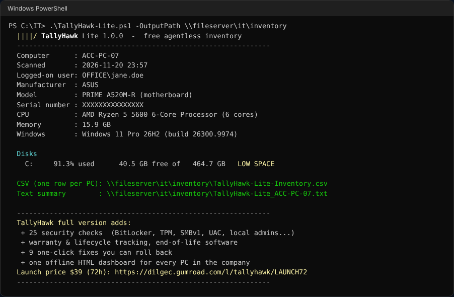
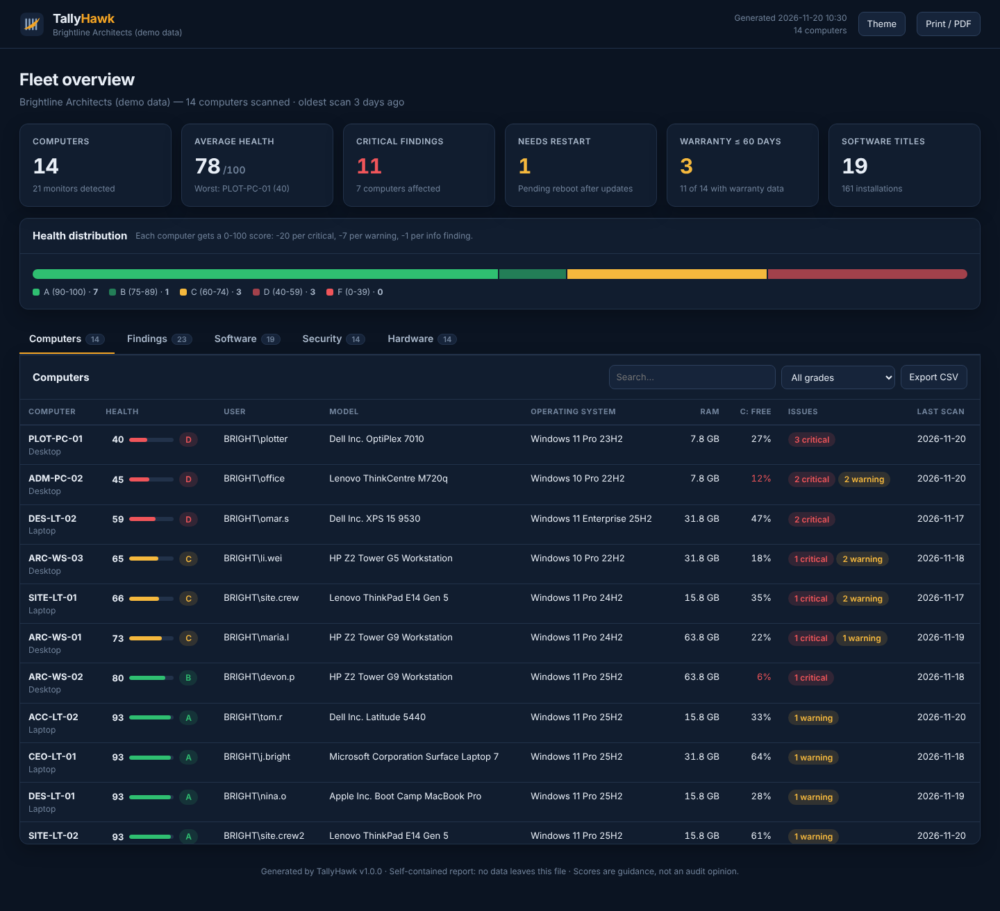
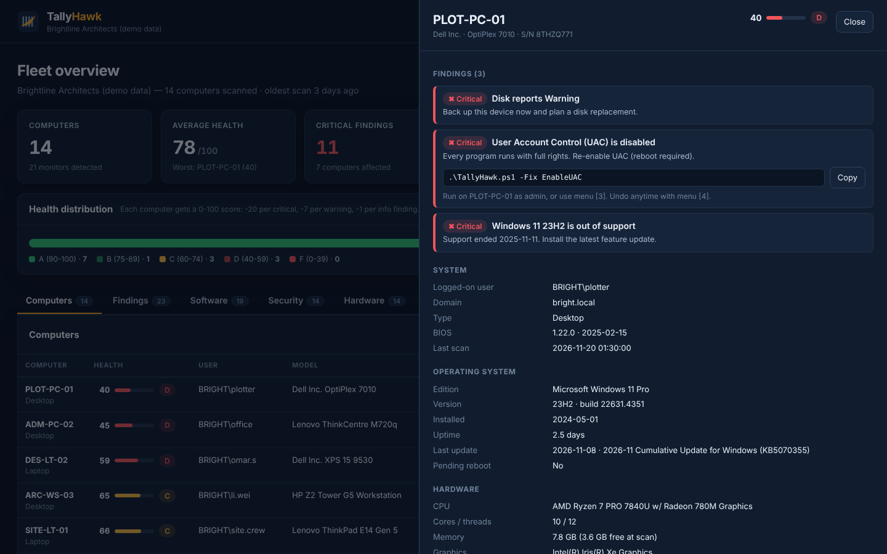

<p align="center"></p>

<h1 align="center">TallyHawk Lite: free agentless Windows inventory script</h1>

<p align="center">
One PowerShell file. No agent, no install, no cloud.<br>
Serial numbers, CPU, RAM, Windows build and disk usage for every PC, in a single CSV.
</p>

<p align="center">
<a href="#quick-start"><b>Quick start</b></a> ·
<a href="#lite-vs-full-version"><b>Lite vs full version</b></a> ·
<a href="https://dilgec.gumroad.com/l/tallyhawk/LAUNCH72"><b>Get TallyHawk ($39 launch price)</b></a>
</p>

---

## The problem

If you look after 20, 50 or 300 Windows PCs without a big RMM budget, simple questions are hard to answer:

- *Which machines are low on disk space?*
- *What's the serial number of the laptop in accounting?*
- *How many PCs still run Windows 10, or an old Windows 11 build?*

The usual answers are a spreadsheet from last year, or a per-device SaaS subscription with an agent on every endpoint.

## The solution

**TallyHawk Lite** is a single read-only PowerShell script. Run it on each PC, or point all of them at one network share. You get:

- a **console summary** with colour-coded disk warnings
- **one CSV row per computer**. Run it again and the PC's row is updated, not duplicated.
- a **plain-text summary** per PC for tickets and documentation

It works on self-built PCs too: when the firmware reports placeholders like *"System Product Name"*, Lite falls back to the motherboard model and serial.



## Quick start

```powershell
# Download TallyHawk-Lite.ps1, then:
powershell -ExecutionPolicy Bypass -File .\TallyHawk-Lite.ps1
```

Fleet mode: every PC appends to the same CSV.

```powershell
.\TallyHawk-Lite.ps1 -OutputPath \\fileserver\it\inventory -Quiet
```

Works as a GPO logon/startup script, an RMM job or an Intune script. Exit code `0` means success.

| What Lite collects | Details |
|---|---|
| Identity | Computer name, logged-on user, manufacturer, model, **serial number** |
| Hardware | CPU model and cores, RAM |
| Windows | Edition, version (e.g. 24H2 / 25H2), full build number |
| Storage | Every fixed drive: size, free space, % used, LOW SPACE / CRITICAL flag |

Requirements: Windows 10/11 or Server 2016+, Windows PowerShell 5.1 (built in) or PowerShell 7. **No admin rights needed.** Tested on English and Turkish Windows 11, so the output always uses dot decimals whatever the system language.

---

## Lite vs full version

Lite tells you **what you have**. The full **TallyHawk - IT Inventory & Health Kit** tells you **whether it's safe and what to fix first**.



| Feature | TallyHawk Lite (Free) | TallyHawk ($39 launch / $49) |
|---|:---:|:---:|
| Hardware, OS & disk inventory | ✅ | ✅ |
| CSV export, one row per PC | ✅ | ✅ |
| Installed software (64-bit, 32-bit **and per-user**) | – | ✅ |
| Monitors, network adapters, BIOS, GPU | – | ✅ |
| **25 security & health checks**: BitLocker (incl. suspended), TPM 2.0, Secure Boot, SMBv1, UAC, firewall, antivirus, local admin analysis | – | ✅ |
| 0-100 health score and A-F grade per PC | – | ✅ |
| Windows 10/11 end-of-support and Windows 11 readiness | – | ✅ |
| End-of-life software detection (Office 2016/2019, SQL 2014/2016, Java 7...) | – | ✅ |
| Warranty & assignment tracking | – | ✅ |
| Windows / Office activation with masked keys | – | ✅ |
| **9 one-click fixes with snapshot + rollback** | – | ✅ |
| **Interactive offline HTML dashboard merging every PC** (search, filter, CSV, PDF) | – | ✅ |
| Weekly scheduled scan, colour console menu, detailed logs | – | ✅ |
| Quick Start & Troubleshooting guides | – | ✅ |
| Price | Free (MIT) | **$39** for the first 72 hours, then $49. One-time, no subscription. |

<p align="center">
<a href="https://dilgec.gumroad.com/l/tallyhawk/LAUNCH72"><b>→ Get TallyHawk for $39 (72-hour launch price)</b></a>
</p>



## More free tools

- [TallyHawk PC Health Report](https://github.com/harundilgec76-dot/tallyhawk-pc-health-report): 0-100 health score and HTML report for one PC
- [TallyHawk Software & License Auditor](https://github.com/harundilgec76-dot/tallyhawk-license-auditor): every installed app, activation status and end-of-life software

## FAQ

**Does it change anything on the PC?** No. Lite only reads WMI/CIM and the registry.

**Does it send data anywhere?** No. Output stays in the folder you choose.

**Can I use it commercially?** Yes, it's MIT licensed.

## License

MIT

---

### Suggested repository topics

`powershell` · `windows` · `sysadmin` · `it-inventory` · `asset-management` · `hardware-inventory` · `msp` · `it-audit` · `windows-11` · `endpoint-management`
